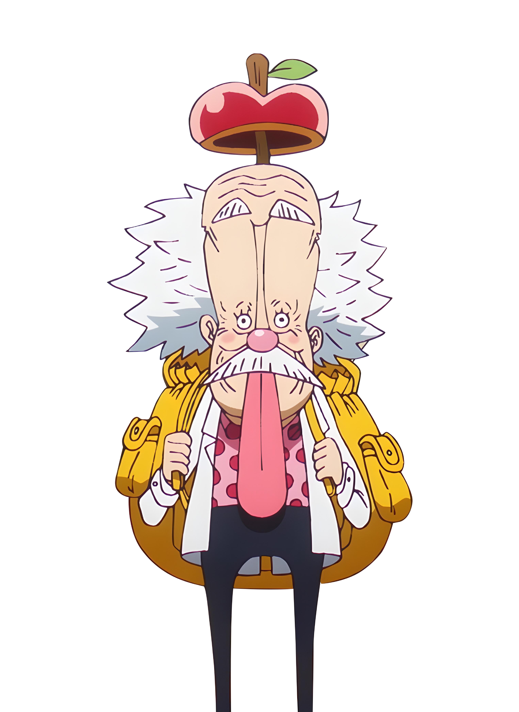

  <picture>
    <source
      media="(prefers-color-scheme: dark)"
      srcset="https://raw.githubusercontent.com/RicardoRuggiero/RicardoRuggiero/output/github-contribution-grid-snake-dark.svg"
    />
    <source
      media="(prefers-color-scheme: light)"
      srcset="https://raw.githubusercontent.com/RicardoRuggiero/RicardoRuggiero/output/github-contribution-grid-snake.svg"
    />
    
  </picture>

   

  

